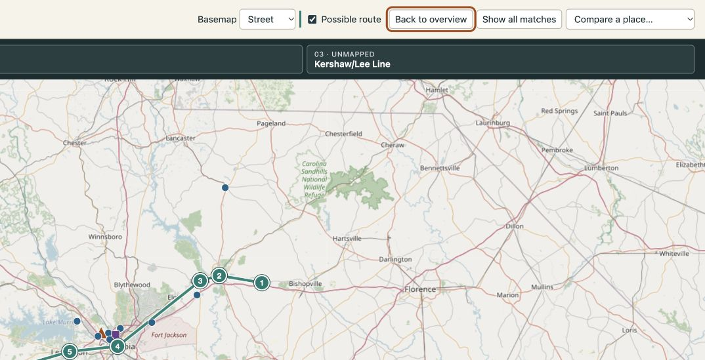
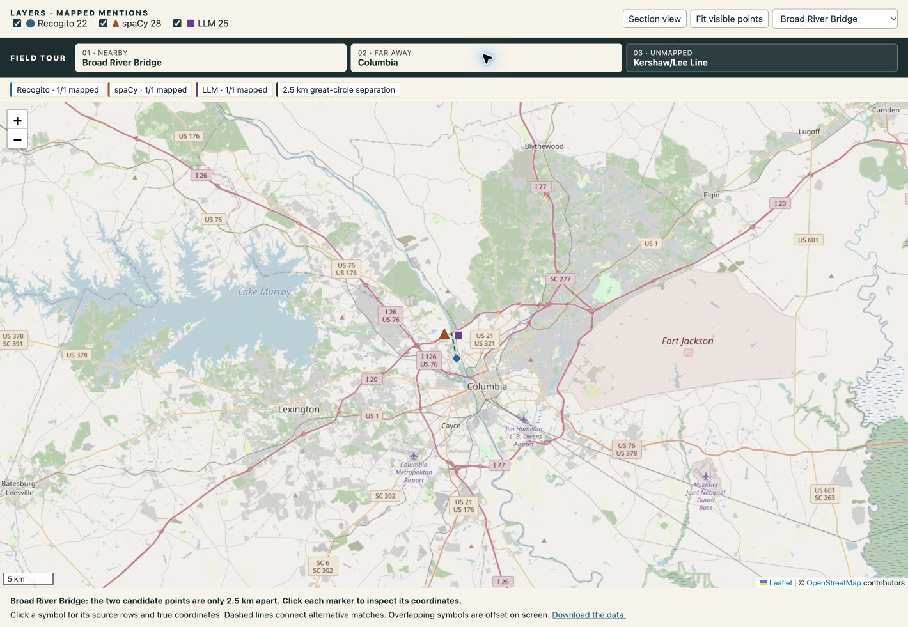

<!doctype html>
<html lang="en"><head><meta charset="utf-8"><meta name="viewport" content="width=device-width,initial-scale=1">
<meta name="description" content="Three ways to geocode Section 5.1 of Ross Goodwin’s 1 the Road. A map and field essay by Bastaki.">
<title>The road with three addresses · Bastaki Spatial Notes</title>
<link rel="stylesheet" href="/assets/assignment-2/field-guide.css">
</head><body>
<a class="skip" href="#essay">Skip to the essay</a>
<header class="mast"><a href="/" class="brand">BASTAKI SPATIAL NOTES</a><a href="/#assignments">ALL ASSIGNMENTS ↗</a></header>
<main>
<section class="hero">

FIELD NOTES / 02 · FALL 2026

<h1>The road with <em>three addresses.</em></h1>

Three ways to place the same names in <em>1 the Road</em>. One South Carolina stretch, and a Columbia that lands 3,429 km away.

<nav aria-label="Jump to section"><a href="#map">Explore the map ↓</a><a href="#essay">Read the field essay ↓</a><a href="/assets/assignment-2/data/">Inspect the data ↗</a></nav>

SECTION 5.1 / READING SEQUENCE

<ol><li>Kershaw / Lee County Line</li><li>Camden</li><li>Columbia</li><li>Leesville</li><li>North Augusta</li></ol>

Selected textual anchors · schematic

</section>
<figure class="map-card" id="map">

01 / INTERACTIVE ATLAS
<h2>One text, three readings</h2>
<a href="/assets/assignment-2/interactive_map.html">Open map on its own ↗</a>

<iframe src="/assets/assignment-2/interactive_map.html" title="Interactive Section 5.1 Leaflet map with three independently toggleable layers"></iframe>
<figcaption>Start in South Carolina. Switch between Street and Satellite using the basemap menu. The optional teal line links selected reviewed places in text order to suggest the car’s westbound path. Select a numbered stop to see the evidence for its location. The exact roads are unknown. Follow the three-stop <strong>Field tour</strong> or select <strong>Compare a place</strong> to see how many mentions each method placed and how far the candidate locations are apart, or <strong>Show all matches</strong> to show outliers. Markers display source records and their original coordinates. Counts refer to mapped mentions, including repetitions. <a href="/assets/assignment-2/data/interactive_map.html">Open the R notebook’s Leaflet export ↗</a></figcaption>

View the map exported from the instructor’s R notebook
<iframe src="/assets/assignment-2/data/interactive_map.html" loading="lazy" title="R Leaflet notebook export with manual, spaCy and LLM layers"></iframe>

</figure>
<article id="essay" class="essay">
THE FIELD ESSAY / DATA AND HUMAN SPACE

<h2 id="the-road-before-it-was-a-map">The road, before it was a map</h2>

The first place in my assigned stretch is a county line. One of the next is a collision center. Putting those two on the same map looks straightforward until you ask what the dots stand for: one is a location along a boundary, the other a local business. An automatic lookup can recognize both names without finding coordinates for either. It can also return an exact-looking coordinate for Camden while putting the road in the wrong state. In Section 5.1 of <em>1 the Road</em>, when do three readings of a place name converge, and when do they only appear to? I compare the labels first and the locations second, then use the text to test what each match means.

Ross Goodwin’s <a href="https://rossgoodwin.com/wordcar/">Word Car project</a> generated text during a March 2017 trip from Brooklyn to New Orleans. A camera, GPS receiver, microphone, and clock supplied inputs while a printer produced text in the car. <a href="https://www.jbe-books.com/products/1-the-road-by-an-artificial-neural">Jean Boîte Éditions</a> published the book in 2018. The resulting text mixes familiar roadside names with descriptions that do not behave like travel directions. A business name can sit beside a dreamlike description of its interior. That makes the book a good test for geocoding: some names refer to real places, but even a correct match cannot turn every sentence into a reliable account of what happened there.

<h2 id="what-i-marked-and-what-i-kept">What I marked, and what I kept</h2>

My Section 5.1 notes start at the Kershaw/Lee County Line and run through Camden, Lugoff, Columbia, Lexington and Leesville, then toward Aiken and the Georgia–South Carolina state line at North Augusta. I compared the notes with the course transcription. In the automated tables I used the first Kershaw/Lee entry through the second North Augusta entry, before the text turns to Augusta. The supplied Recogito export has a matching run at character offsets 47,248–54,219, ending at Leesville. My notes cover later places too, but the supplied export does not provide a matching run of verified manual coordinates for them. The manual layer therefore shows the recoverable annotations, and the <a href="/assets/assignment-2/data/field-notes.csv">unresolved notes</a> document the later part without inventing markers. The export is a shared class record; I distinguish it from my own notes.

The <a href="/assets/assignment-2/data/">data folder</a> contains the scoped inputs and an audit. The copies used were downloaded on November 9, 2026. I retained the original coordinates, gazetteer references, and comments in the audit, then added separate map fields. Of 31 Recogito records, 22 were mapped, five redundant matches for the same text occurrence were excluded, and four were held. Repeated names at different offsets still count as separate mentions; the map groups them at 14 distinct positions. I recovered six additional coordinate pairs from comments where the cleaned coordinate fields were blank. Changing a typographic minus to a standard minus, for example, recovered the longitude for Polo Park without changing the coordinate itself.

Camden and Columbia needed interpretation beyond formatting. The three original Camden annotations pointed to New Jersey. The county line and Lugoff support a South Carolina match, so the review uses a <a href="https://www.cityofcamden.org/wp-content/uploads/2024/03/Downtown-Camden-Key-Facts.pdf">representative downtown point from the City of Camden</a>. Four Columbia offsets each had two competing matches, in South Carolina and Tennessee. Polo Park and the Broad River give the name a local context, so I retained one <a href="https://www.geonames.org/4575352/columbia.html">South Carolina city point</a> per occurrence. Those decisions have limits: the Leesville point is an approximate town-area match from the export, and three generic gas-station records were held rather than assigned to a specific BP.

<h2 id="where-the-methods-agree-and-why-that-can-mislead">Where the methods agree, and why that can mislead</h2>

I separated <strong>recognition</strong> (which words are marked as a place) from <strong>resolution</strong> (where the name ends up). The instructor’s spaCy workflow used named entity recognition and geopy; the LLM-assisted workflow used a TEI transcription, entity recognition, and coordinate lookups. I kept the supplied automated coordinates unchanged and used their source row numbers for reference. Each section slice contains 37 rows. SpaCy maps 28 and leaves nine blank; the LLM-assisted file maps 25 and leaves 12 blank. These are coverage figures, not accuracy scores. The manual export also includes duplicates and has a different endpoint, so its denominator is not directly comparable.

I grouped repeated rows by their exact place label and compared the stored coordinate pairs. The automated tables share 18 exact labels. Thirteen have identical coordinate pairs in both tables, and five are blank in both. Camden is one of those agreements: the automated match is about 799 km from the reviewed South Carolina point. Columbia is farther off: each file sends all five mentions to the same point in Colombia, about 3,429 km from the reviewed city. Polo Park, read as a park near Columbia in the manual notes, gets a point about 2,204 km away in the automated layers. Agreement here can repeat a lookup error. The files demonstrate that the coordinates match; they do not establish which provider supplied them or that two independent systems verified them.

<figure><figcaption><b>02 / South Carolina.</b> The reviewed points cluster along the section. The initial extent also includes North Augusta, where the two automatic city matches overlap.</figcaption></figure>
<figure><figcaption><b>03 / Columbia.</b> One label, two interpretations, about 3,429 km apart. The orange and purple marks share the same stored coordinate.</figcaption></figure>

<table><caption>04 / How far apart are the candidate points?</caption>
<thead><tr><th scope="col">Place label</th><th scope="col">Manual vs. shared automated point</th><th scope="col">What changes</th></tr></thead>
<tbody>
<tr><th scope="row">Broad River Bridge</th><td>2.5 km</td><td>Candidate crossing</td></tr>
<tr><th scope="row">Broad River</th><td>107 km</td><td>Position along a waterway</td></tr>
<tr><th scope="row">Camden</th><td>799 km</td><td>State</td></tr>
<tr><th scope="row">Polo Park</th><td>2,204 km</td><td>Country and feature</td></tr>
<tr><th scope="row">Columbia</th><td>3,429 km</td><td>Country</td></tr>
</tbody></table>

The Broad River examples complicate a simple right-or-wrong reading. The manual and automated bridge points are about 2.5 km apart, small enough to look like agreement at statewide zoom but meaningful if the question is which crossing the text names. The river points differ by about 107 km. A river is a line, so two distant points could still refer to the same waterway. The manual point has a better fit with the surrounding Columbia mentions, but the distance alone cannot adjudicate what feature each record describes. Distances here are great-circle distances between the recorded coordinates, rounded for readability.

<h2 id="when-a-blank-is-better-than-a-pin">When a blank is better than a pin</h2>

Both systems found four mentions of the Kershaw/Lee County Line and the full collision-center name without producing coordinates. The manual layer has points from annotation comments for both. The pattern reverses near the end. SpaCy shortens the border name to “South Carolina State Line” and puts it roughly 188 km from the shared North Augusta point. The LLM-assisted table preserves the two-state name and leaves it blank. Both files place North Augusta itself, which is useful as a city reference, but that point cannot identify the crossing. The longer span gives a reader better evidence to investigate, even though it adds no marker.

Other gaps come from the source. The transcription breaks Lexington across a line, and spaCy accepts a fragment as a place and maps it far from South Carolina. The LLM output avoids that fragment but still lists unresolved forms like “Aikena” and “Efficient LLC.” The text says “Exit 18” without supplying a unique highway; both workflows return the same point in Japan. A named exit may look more specific than a town name, yet it is nearly meaningless to a lookup without a route. My note about a mountain is similarly weak: the thirteen-minute gap describes reading order and time, not enough evidence to locate a summit.

The same distinction matters outside a novel. If these pins were used to estimate access to a service along a corridor, a confident match to the wrong branch could change the result more than leaving one station unresolved. I would review those cases by feature type: check nearby towns before choosing a city, check the road number before placing an exit, and record a crossing or area explicitly when the source names a boundary or region. The map makes those decisions inspectable instead of hiding them in the lookup.

<h2 id="what-the-machine-gets-to-see">What the machine gets to see</h2>

In the introduction, McDowell writes that the nearby locations were “exposed by the Foursquare API” (p. 28). That helps explain why gas stations and businesses share the page with rivers and borders. A chain name such as Flying J is readily searchable, but the name alone cannot tell a search service which branch the car passed. What gets recorded by the car, what survives transcription, what a tagger recognizes, and what a lookup can resolve are successive choices. The map layers make some of those choices legible. They do not measure everything the car encountered or show how much text the editor omitted.

In chapter 8, “Mapping and GIS,” of <a href="https://books.google.com/books?id=F8IZEAAAQBAJ"><em>The Digital Humanities Coursebook</em></a>, Johanna Drucker distinguishes locating something from studying how a place is inhabited and experienced. A city dot can locate North Augusta but cannot tell us whether the narrator is at a crossing, in a station, or recalling a scene. Her related <a href="https://dhdebates.gc.cuny.edu/read/untitled-88c11800-9446-469b-a3be-3fdb36bfbd1e/section/0b495250-97af-4046-91ff-98b6ea9f83c0">essay on humanistic interpretation</a> helps explain why I treat a marker as a claim with a source. The map starts with the local reading, but one click exposes the full spread of automatic results. Colors and shapes distinguish the methods. Coincident symbols move apart on screen, while popups keep the actual coordinates. Blank matches remain in the data folder. Making absence visible matters as much as making overlap clickable: an unresolved crossing gives the reader a question to investigate; a misplaced pin can make the question disappear.

I used Codex to add features to the interactive map.

<strong>READY FOR GRADING</strong>

</article></main>
<footer>BASTAKI / DATA AND HUMAN SPACE<a href="#map">Back to the map ↑</a></footer>
</body></html>
